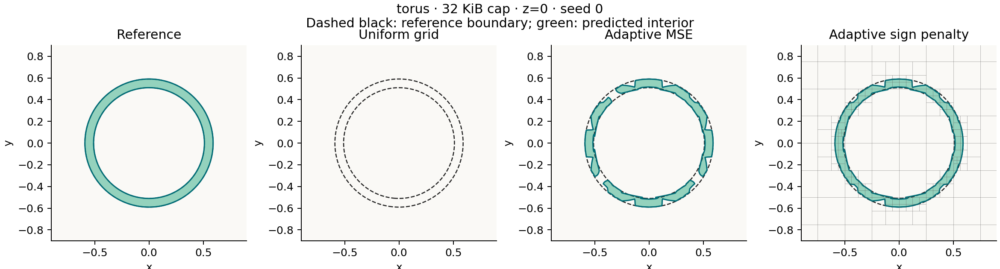

# Development experiment

Measured on 6 October 2026, on an Intel Core i9-10900K with a Release build using
MSVC 19.44. This is a first numerical experiment, not a final held-out study.

Four analytic shapes, feature 0.04, fitting seeds 0/1/2, and storage caps
8/32/128 KiB. Each adaptive fit uses 8,192 mixed samples. Each evaluation
distribution has 8,192 new samples. The MSE and sign-penalty octrees share their
training pool. The uniform grid shares the byte cap and evaluation points.

## What the experiment says

At the 32 KiB cap, the sign-penalty octree uses 32,644 bytes and the uniform grid
uses 32,064 bytes. Their discrete allocation sizes differ by 580 bytes. Both
include the 64-byte C++ object. The following scores average three seeds:

| Diagnostic | Uniform grid | Adaptive MSE | Adaptive sign penalty |
|---|---:|---:|---:|
| Torus interior probe retention | 0.0% | 81.5% | 94.5% |
| Thin-box interior probe retention | 0.0% | 100.0% | 100.0% |
| Gap exterior probe preservation | 0.0% | 100.0% | 100.0% |
| Torus near-surface MAE | 0.029334 | 0.016761 | 0.012639 |
| Thin-box near-surface MAE | 0.016721 | 0.006125 | 0.005452 |
| Sphere near-surface MAE | 0.003360 | 0.009354 | 0.007481 |
| Two-sphere near-surface MAE | 0.006638 | 0.010056 | 0.009787 |

Adaptive allocation helps the thin wall and ring at this cap. It also preserves
the known gap points, even though the grid has lower mean near-surface error on
the two-sphere case. The sphere is a useful negative control: the grid gives
better distance accuracy. The adaptive queries are slower; consult the raw
timings rather than treating increased compression accuracy as free.

The sign penalty helps the torus beyond MSE allocation. It does not improve
every metric: thin-box near-surface CVaR99 rises from 0.035482 with MSE allocation
to 0.048373 with the sign penalty. A method that protects signs can make the
largest distance errors worse. This is a useful research question for the next
loss-policy experiment.



The dashed curves are the reference; green marks the predicted interior.
The last panel shows the adaptive leaves intersecting the slice. One slice and
known-point probes do not prove 3D connectedness or correct topology.
These fixtures are axis aligned. The 32 KiB grid has 20 samples per axis and
no lattice plane at z=0: its closest z samples are approximately +/-0.0526,
outside the 0.04 torus tube and thin-box half-thickness. All those grid vertex
distances are positive, so interpolation cannot recover an interior. This
explains the complete failure at that cap and makes alignment stress tests
essential before a broader claim.

## Evidence and reproduction

Compact evidence lives in [development/](development/): raw metrics, exact
configurations, paired seed summaries, input/executable hashes, source
fingerprints and selected figures. Full slices and leaf rectangles remain in
the ignored local `runs/` directories and can be regenerated.

```powershell
python scripts\sweep.py --exe build-core\Release\sdf_bench.exe --out runs\analytic-reproduction --features 0.04
python scripts\report.py runs\analytic-reproduction
```

The analytic measurements use the CGAL-disabled executable: it isolates the
same distance-field code with analytic reference distances. The mesh experiments
use a separate CGAL-enabled build. Shapes match neural-geometry dimensions, but
the random generator, surface sampler, field representation and hardware path
are different. These measurements are independent of that project's earlier
neural pilot and do not establish a neural-versus-octree result.

The sweep hashes source files, fixtures and analysis scripts with normalized
line endings and trailing whitespace. Analysis also
records its own script hash. Regeneration can change runtime measurements;
different C++ standard libraries can also generate different Gaussian samples.
Three seed-level bootstrap intervals provide only
coarse development variability; they are not evidence across a population of
unseen meshes.

## Closed-mesh check

The CGAL 6.2.1 / EPECK Release build passes the same correctness suite plus known
mesh distances, surface sampling, analytic-box comparisons, and rejection of
open, degenerate, self-intersecting and unnormalized meshes. CTest passes; the
test executable reports 10,081 assertions. The analytic-only build also passes.
GitHub Actions is configured; no remote CI run is claimed.

A closed thin-box mesh pilot uses three seeds, 8/32 KiB caps, 4,096 fitting and
evaluation samples, and 27 fixed mesh probes (nine inside, eighteen outside).
At 32 KiB, both adaptive methods retain all interior probes; the grid retains
none. Mean near-surface MAE is 0.016535 for the grid, 0.006365 for adaptive MSE,
and 0.005857 for the sign-penalty octree. Warm median query batch averages are
approximately 23.3, 48.7 and 46.1 ns/query respectively on this machine.

The [mesh-wall report](development/mesh-wall/report.html) includes raw
measurements and separate construction costs. These measurements use an exact
mesh reference, but still have the axis-alignment and probe-coverage limits of
the analytic experiment. Do not pool the two experiments: the fitting sample
counts and surface samplers differ.

A [curved-mesh pilot](development/mesh-torus/report.html) uses a closed,
2,048-triangle torus, seed 0, a 32 KiB cap, 2,048 fitting/evaluation samples and
512 fixed probes. Interior probe retention is 0% for the grid, 83.6% for adaptive
MSE and 86.3% for the sign penalty. Near-surface MAE falls from 0.029151 to
0.014897 with the sign penalty, but its CVaR99 is 0.067982 versus 0.043186 for
MSE allocation. The rendered adaptive rings still have gaps. This one-seed
pilot validates curved input and exposes a remaining failure; it does not
establish topology preservation or multi-seed performance on meshes.

```powershell
python scripts\sweep.py --exe build\Release\sdf_bench.exe --out runs\wall-reproduction --mesh fixtures\thin_box.off --probes fixtures\thin_box_probes.csv --seeds 0,1,2 --budgets 8192,32768 --train 4096 --test 4096 --slice-size 129
python scripts\sweep.py --exe build\Release\sdf_bench.exe --out runs\curved-reproduction --mesh fixtures\torus.off --probes fixtures\torus_probes.csv --seeds 0 --budgets 32768 --train 2048 --test 2048 --slice-size 129 --slice-plane xy
```

## Next decision

Keep both objectives for the thickness sweep. Select settings on development
geometries, freeze them, then measure new thicknesses and rotated/translated
instances. The next aim is to find where the storage/error/latency frontier
changes, and whether a continuity constraint reduces the octree's largest
errors without losing its thin-feature advantage.
