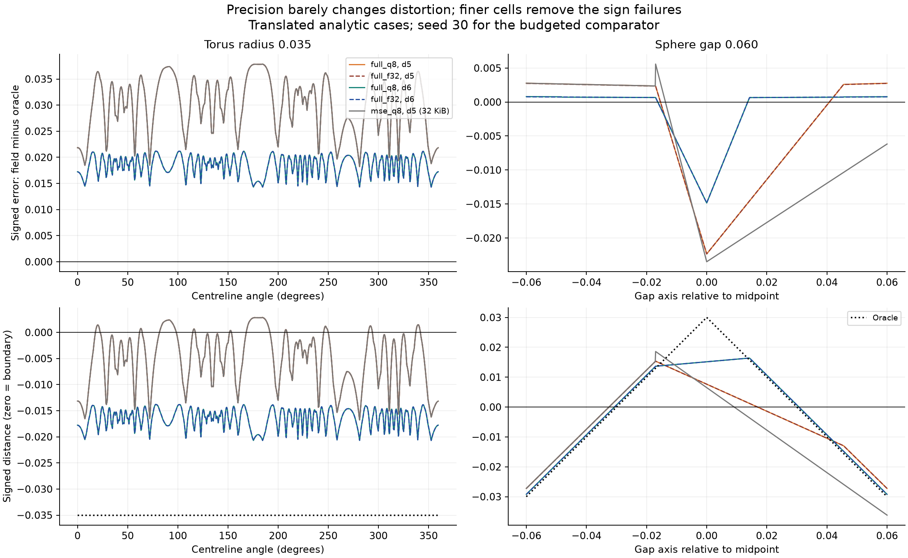
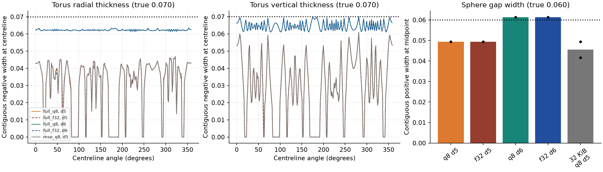

# What causes the remaining geometric distortion?

Measured 8 October 2026. **Spatial interpolation is the main limitation in the
0.035 torus and 0.06 sphere gap.** Replacing q8 with f32 at depth five does not
recover either feature. Full depth six recovers both under the unchanged
criteria. Fitting samples are present in the failing regions. The next justified
intervention is selective deeper q8 refinement, with an equal-byte result still
to be demonstrated.

[Local report and all-case tables](distortion-v1/index.html)
and [pre-run protocol](distortion-protocol.md). This follow-up uses 50 fields:
five shape/feature cases, two seeds and five field configurations. It includes
all larger features from the prior sweep: torus 0.06/0.10 and gap 0.10.
Depth-six exact allocation was **not** run; the candidate/DP depth limit remains
five. A direct builder creates full depth-six buffers without a candidate tree.

## Precision does not fix the failures

| Target feature | Full d5 q8 recall | Full d5 f32 recall | Full d6 q8 recall | Full d6 f32 recall |
|---|---:|---:|---:|---:|
| Torus radius 0.035, interior probes | 80.08% | 80.47% | 100% | 100% |
| Sphere gap 0.060, exterior probes | 85.16% | 85.16% | 100% | 100% |

The other probe class passes at 100% throughout these full fields. All four
full representations have the expected closed manifold topology at both 64
and 96 extraction cells on these cases. Depth five therefore fails through
probe retention, despite apparently correct mesh topology. Both depth-six
encodings pass at the target and every larger tested feature, on both seeds.
The minimum **tested** recovered features become torus 0.035 and gap 0.060;
smaller features were not included in this focused diagnostic.

At fixed locations the signed error is decomposed exactly as:

`(q8 - f32) + (f32 - double-corner interpolation) + (double-corner interpolation - oracle)`.

The last term isolates trilinear interpolation, while the middle term measures
float corner rounding. On the 1,024-angle torus centreline, depth-five peak
absolute interpolation error is **0.037839**, versus **0.0001012** from q8 and
less than 7.3e-10 from float rounding. Across the 1,025-point sphere-gap profile,
the corresponding maxima are **0.022346**, **0.00002748** and less than 5.5e-10.
These are separate maxima over named profiles, not additive absolute-error
budgets or domain-wide bounds.



The torus centreline has a positive interpolation bias. At some angles that
bias exceeds the true radius 0.035, making the original centreline exterior
even while an extracted toroidal component survives nearby. In the sphere gap,
the union distance switches nearest sphere at the midpoint: interpolation
across that distance ridge depresses the gap distance. The translated cell
alignment makes the depth-five boundary displacement asymmetric. Depth six
reduces both effects; changing storage precision barely moves the curves.

## Recovery still permits shape error

| Width diagnostic | Truth | Full d5 q8 | Full d5 f32 | Full d6 q8 | Full d6 f32 |
|---|---:|---:|---:|---:|---:|
| Torus median radial thickness | 0.070 | 0.03688 | 0.03698 | 0.06221 | 0.06221 |
| Torus median vertical thickness | 0.070 | 0.03098 | 0.03101 | 0.06452 | 0.06449 |
| Sphere gap width on centre axis | 0.060 | 0.04941 | 0.04941 | 0.06137 | 0.06138 |

Torus widths are measured at 256 angles, as the contiguous negative interval
containing the analytic centreline. If the centreline is exterior the recorded
width is zero: 51 angles for d5 q8 and 50 for d5 f32. **Zero here does not mean
there is no displaced tube elsewhere on that line.** Depth six has no such
zero widths, but median radial thickness is still 11.1% too small and vertical
thickness 7.8% too small. The d6 q8 gap is 2.3% wider than truth. Passing the
frozen recovery rule is not a claim of exact dimensional fidelity.



Each side is scanned at spacing feature/2048, then its first sign transition
is bisected 40 times. The same procedure reproduces analytic oracle widths
within 1e-12. It reports sign-transition positions, which may be discontinuous
for adaptive fields. Raw left/right positions and missing brackets are retained;
there were no missing brackets in this run. These diagnostics supplement the
frozen recovery rule without changing it.

## Samples are present; allocation sometimes adds distortion

For both seeds, all **51/51** failed d5 q8 torus probes and **19/19** failed d5
q8 gap probes lie in leaves containing fitting samples of the required sign.
Full fields do not use fitting labels to choose corner values, so their failure
already rules out fitting coverage as its cause. The occupancy check also rules
out completely empty or missing-sign leaves at these specific failed probes;
it does not establish adequate sample density everywhere.

At the 32 KiB MSE cap:

- Both torus seeds retain 80.08% of interior probes. All 51 failing probes per
  seed are already in depth-five leaves, with interior fitting samples. A
  depth-five allocation change cannot improve those particular leaf values.
- Gap seed 30 retains 68.75% of exterior probes. All 40 failures lie in
  depth-four leaves with exterior fitting samples; recovered width is 0.04165.
  Full d5 improves this to 85.16% and width 0.04941, isolating an additional
  allocation effect.
- Gap seed 31 retains 85.16%. All 19 failures are at depth five, with exterior
  samples; its width matches full d5. Spatial resolution remains the residual
  limit even after allocating depth five there.

Thus allocation contributes in one gap seed, but cannot explain away the
full-field failures. Coverage observations are local and descriptive; no new
sampling policy has been evaluated.

## Error, bytes and construction cost together

Means across fitting/evaluation seeds 30 and 31, each with 100,000 independent
uniform and 100,000 near-surface queries. Near noise is feature/2. The cases and
sampling settings were used previously; these are controlled diagnostic results,
not an unseen-shape evaluation. The full fields are identical between seeds.

| Target | Field | Bytes | Uniform MAE / CVaR99 | Near MAE / CVaR99 | Build ms |
|---|---|---:|---:|---:|---:|
| Torus 0.035 | Full d5 q8 | 674,148 | 0.000869 / 0.008801 | 0.010148 / 0.029964 | 11.00 |
| Torus 0.035 | Full d5 f32 | 1,198,436 | 0.000868 / 0.008801 | 0.010147 / 0.029964 | 7.62 |
| Torus 0.035 | Full d6 q8 | 5,392,740 | 0.000218 / 0.002305 | 0.002796 / 0.015009 | 81.03 |
| Torus 0.035 | Full d6 f32 | 9,587,044 | 0.000218 / 0.002306 | 0.002796 / 0.015010 | 61.85 |
| Torus 0.035 | 32 KiB MSE d5 q8 | 32,628 | 0.009518 / 0.029193 | 0.010494 / 0.029972 | 70.74 |
| Gap 0.060 | Full d5 q8 | 674,148 | 0.001028 / 0.009274 | 0.002322 / 0.015135 | 9.38 |
| Gap 0.060 | Full d5 f32 | 1,198,436 | 0.001028 / 0.009276 | 0.002322 / 0.015129 | 6.97 |
| Gap 0.060 | Full d6 q8 | 5,392,740 | 0.000276 / 0.004631 | 0.000600 / 0.006265 | 74.71 |
| Gap 0.060 | Full d6 f32 | 9,587,044 | 0.000276 / 0.004630 | 0.000600 / 0.006265 | 56.13 |
| Gap 0.060 | 32 KiB MSE d5 q8 | 32,628 | 0.009875 / 0.026430 | 0.006722 / 0.017796 | 57.39 |

Full d5/d6 construction makes 262,144/2,097,152 oracle calls, only at terminal
corners, counting duplicates. It needs no fitting data, candidate tree or DP.
Budgeted d5 construction makes 309,592 calls including 10,000 fitting labels,
and includes candidate generation, allocation and packing. It uses the existing
three-encoding candidate container, retaining q8 only. These are two serial
Release-build timings, not a performance confidence interval; evaluation,
meshing and evidence writes are excluded. No temporary/peak memory claim is made.

Full d6 q8 uses about 165 times the 32 KiB cap. Its success identifies the
representational headroom, not an affordable solution. Existing 32 KiB recovery
thresholds remain torus 0.060 and gap 0.100 in this follow-up.

## Chosen next intervention and success target

Investigate **selective depth-six q8 candidates** near regions with large local
interpolation residuals, reallocating bytes from less useful leaves. Do not
spend the first intervention on local f32 precision or merely adding fitting
samples. Candidate selection must use fitting/construction information, not
the evaluation probes used here to diagnose failures. The sphere-gap result
also motivates checking whether allocation retains those candidates once built.

The next success target is recovery of torus radius **0.035** and/or sphere gap
**0.060** at the same **32,768-byte cap**, while every larger previously tested
feature still passes the existing oracle, topology, two-resolution, two-seed
and >=95% probe conditions. Report uniform/near MAE, CVaR99, actual bytes and
complete construction cost beside that recovery improvement, and retain the
width diagnostics. No deeper budgeted candidate/allocation intervention has
been implemented or claimed successful in this initial check.

## Verification and reproduction

All four C++ suites pass. Added tests show the direct full builder is byte-for-byte
identical to candidate packing at depths 0, 2 and 5 for q8/f32, and check depth-six
affine reproduction, oracle counts, boundary queries and invalid inputs. The
existing test rejecting depth-six candidate trees still passes.

An independent NumPy decoder verifies complete byte coverage, encoding, depths,
byte caps, oracle labels, metrics and **all 10,017,960 saved C++ queries** across
50 fields. The two-seed full buffers are hash-identical. Widths are checked
against analytic controls. Raw evidence and source/executable snapshots have
SHA-256 manifests; the analysis/report scripts are separately preserved in the
compact report. A first analysis attempt encountered a Python q8 buffer-indexing
error before emitting results; its directory is retained, and the corrected
analysis is `runs/distortion-v1-analysis-02`.

```powershell
cmake -S . -B build-core -DSDF_WITH_CGAL=OFF
cmake --build build-core --config Release --parallel 4
ctest --test-dir build-core -C Release --output-on-failure
.venv/Scripts/python.exe scripts/distortion_run.py runs/distortion-new --exe build-core/Release/sdf_distortion_bench.exe
.venv/Scripts/python.exe scripts/distortion_analysis.py runs/distortion-new runs/distortion-new-analysis
.venv/Scripts/python.exe scripts/distortion_report.py runs/distortion-new runs/distortion-new-analysis runs/distortion-new-report
```

Use new directories; interrupted/failed output is retained. Python requires
NumPy and Matplotlib from the existing analysis environment. The compact report
is in `docs/distortion-v1`; complete samples, predictions, buffers and meshes
remain locally in `runs/distortion-v1`, with pre-run source/executable snapshots
in `runs/distortion-v1-source`. These raw directories are not Git-tracked or
bundled in the compact report. No remote CI or publication was performed.
