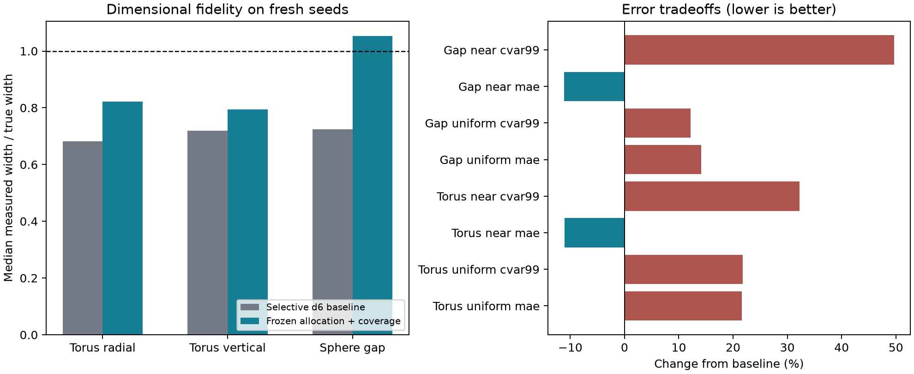

# Allocation coverage recovers the sphere gap within 32 KiB

Measured 8 October 2026. After three interventions, the frozen method recovers
the **0.060 sphere gap at 32,628 actual bytes**, improves torus thickness, and
preserves the 0.035 torus recovery and every larger control on fresh seeds
140/141. Recovery criteria are unchanged. This is a geometry/error tradeoff:
near-surface MAE improves about 11%, but near-surface CVaR99 worsens **32% for
the torus and 50% for the gap**. Torus thickness remains substantially too small.

[Research log](fidelity-log.md) · [Frozen selection](fidelity-v1/selection.json) ·
[All cases and costs](fidelity-v1/summary.csv) ·
[Dimensional errors](fidelity-v1/width_summary.csv) ·
[Per-seed metrics](fidelity-v1/metrics.csv)



## What changed and why

The starting method is the [selective depth-six result](refinement-study.md):
full depth-five candidates, K=32 deeper parents ranked by decoded q8 fitting
SSE, then exact MSE tree-knapsack allocation. Its gap candidates cover the
failure, but the allocation retains none. Its recovered torus remains too thin.

The final method keeps the representation, original fitting pool, residual
ranking, maximum depth and byte cap. It changes three things, in this order:

1. Add a **0.001 penalty per wrong-sign fitting sample** to normalized SSE.
2. Increase the residual-ranked candidate pool from **32 to 128 parents**.
3. Add **4 × 4 × 4 interior cell-centre samples per selected parent** to the
   allocation fitting pool, with unit weight. Ranking still uses only the
   original fitting pool. These 8,192 additional oracle labels expose local
   errors that sparse random fitting samples miss.

The DP exactly minimizes the additive objective over this candidate tree and
budget. That fitting guarantee is not a guarantee about geometric recovery,
dimensional error, or held-out distance error. No analytic shape identifier,
recovery probe or evaluation query is used in cell selection or allocation.
The experiment is motivated and selected using these familiar analytic shapes.

## Three interventions, including unsuccessful choices

All previous evaluation cases are development evidence, including seeds 40/41.
The screen uses the original five feature cases, 10,000 fitting points and
10,000 queries per distribution. Geometry probes and widths guide development
selection; they never become training labels. Larger probe controls must pass.

| Intervention / configuration | Worst target recall | Mean absolute relative width error |
|---|---:|---:|
| Sign penalty 0.0001, K=32 | 68.75% | 27.85% |
| Sign penalty 0.001, K=32 | 85.16% | 26.60% |
| Sign penalty 0.01, K=32 | 85.16% | 26.60% |
| K=128, penalty 0.001 | 85.16% | 19.91% |
| K=512, penalty 0.001 | 85.16% | 19.91% |
| K=128, penalty 0.001, 2³ extra samples/cell | 100% | 16.52% |
| **K=128, penalty 0.001, 4³ extra samples/cell** | **100%** | **15.51%** |

The width score gives equal weight to six target case/axis groups: radial and
vertical torus widths and sphere-gap width, each at two seeds. Within a torus
group it averages absolute relative error across all 256 angles. Missing widths
would prevent a finite selection score. All screened larger probe controls pass.

Increasing the sign penalty alone plateaus: one failing gap leaf contains seven
random fitting samples with **no fitting sign error**. Broader candidates improve
the torus but leave the gap unchanged. Deterministic allocation coverage resolves
that development failure. q=4 has lower aggregate dimensional error than q=2
and 100% recall on every larger control, at higher construction cost.

The selected choice then passes full development topology/oracle checks at
64/96 cells. Selection and computational source hashes are frozen **before**
fresh seeds 140/141. No method was changed after their results were inspected.
All seven screen configurations, including failures, remain saved and verified.

## Frozen recovery and larger controls

Final evaluation uses 10,000 random fitting samples (half uniform, half near
surface, noise feature/2), translation (0.017,-0.023,0.011), and **100,000 fresh
queries per distribution per case**. Paired fitting seeds are 140/141; query
seeds use the unchanged +10000/+20000 offsets. Samples match across methods.

Recovery still requires both probe recalls >=95%, a closed manifold with
component Euler values [0] for torus or [2,2] for spheres, matching oracle
controls at **both 64 and 96 extraction cells**, both seeds, and success at
every larger tested feature. All required topology checks pass; the baseline
gap fails its sign probes. Every field occupies **32,628 bytes**.

| Shape / feature | Selective d6 baseline | Frozen method | Relevant recall, baseline → new, seeds 140 / 141 |
|---|---|---|---|
| Torus 0.035 | Pass | Pass | Inside: 100% / 99.22% → 100% / 100% |
| Torus 0.060 | Pass | Pass | Inside: 100% / 100% → 100% / 100% |
| Torus 0.100 | Pass | Pass | Inside: 100% / 100% → 100% / 100% |
| Sphere gap 0.060 | Fail | **Pass** | Outside: 68.75% / 68.75% → 100% / 100% |
| Sphere gap 0.100 | Pass | Pass | Outside: 95.31% / 95.31% → 100% / 100% |

Complementary recalls are 100%. The minimum **tested** recovered sphere gap
improves from .100 to .060; torus minimum remains .035. Smaller sizes were not
tested. The retained 32-cell diagnostic fails on the thin torus for the oracle
and final method: five components instead of one. This extraction-resolution
failure is not hidden or used to change the existing recovery rule.

## Dimensional fidelity is improved, not solved

The width procedure is unchanged: first sign transitions around the centreline
at 256 torus angles (radial/vertical) or around the sphere-gap midpoint, scanned
at feature/2048 then refined by 40 bisections. Wrong centre signs give zero;
missing brackets stay missing. Adaptive transitions may be discontinuities.
Analytic oracle widths independently reproduce the true dimensions within 1e-12.

| Target / axis | Truth | Baseline width, seeds 140 / 141 | Frozen width, seeds 140 / 141 | Mean absolute relative error, baseline → frozen |
|---|---:|---:|---:|---:|
| Torus median radial thickness | .070 | .047688 / .047887 | .057606 / .057427 | 30.13% → **19.12%** |
| Torus median vertical thickness | .070 | .050321 / .050321 | .055410 / .055687 | 30.96% → **19.17%** |
| Sphere gap axis width | .060 | .041651 / .045289 | .063191 / .063191 | 27.55% → **5.32%** |

The error column averages absolute error over all angles and seeds; it is not
the error of the median. The torus median remains about **18% too thin radially
and 21% vertically**. Gap width is **5.32% too large**. Target zero-width counts
fall from two per torus axis across both seeds to zero; no target brackets are
missing. Widths supplement the unchanged recovery rule, rather than replacing it.

## Errors and construction costs

Two-seed means, distances in normalized scene units. CVaR99 averages the worst
1,000 absolute errors per 100,000-query distribution. These are descriptive
paired results, not population confidence intervals.

| Target / method | Actual bytes | Uniform MAE / CVaR99 | Near MAE / CVaR99 | Oracle calls | Construction ms |
|---|---:|---:|---:|---:|---:|
| Torus .035, baseline | 32,628 | .010268 / .031440 | .008422 / .025424 | 311,640 | 73.45 |
| Torus .035, frozen | 32,628 | .012485 / .038290 | .007493 / .033620 | 325,976 | 94.81 |
| Gap .060, baseline | 32,628 | .009903 / .025866 | .006609 / .017461 | 311,640 | 64.74 |
| Gap .060, frozen | 32,628 | .011305 / .029020 | .005875 / .026132 | 325,976 | 91.84 |

Torus uniform MAE/CVaR99 worsen **21.59%/21.79%**; near MAE improves **11.04%**
while near CVaR99 worsens **32.24%**. Gap uniform MAE/CVaR99 worsen
**14.16%/12.19%**; near MAE improves **11.11%** while near CVaR99 worsens
**49.66%**. The method favors feature recovery at the expense of error tails.
The compact tables include all larger-control metrics and every per-seed cost.

The final tree proposes 128 deeper splits and retains 70/71 for the target
torus, 18/16 for the target gap. The baseline retains 32/32 and 0/0 respectively.
Retained storage includes the 64-byte query object and complete packed buffer;
140 unused bytes cannot buy another 144-byte q8 split. Temporary trees, loss
arrays, allocator overhead and the oracle are excluded from retained storage.

Construction counts the 10,000 random labels, all duplicated corner calls,
8,192 deeper corner calls and 8,192 extra allocation labels. Calls rise **4.60%**
over the K=32 baseline. Timing includes labels, candidate generation/encoding,
ranking, extra labels, loss computation, exact DP and packing. Evaluation,
mesh extraction and evidence writing are excluded. The existing three-encoding
temporary tree is retained; final fields use q8 only. No peak-memory or general
runtime claim is made. Timings are serial Release measurements on this machine.

## Verification and reproduction

Final independent verification passed for all **20 fields and 4,207,184 saved
C++ queries**: NumPy decodes the packed bytes, recomputes oracle truth, errors,
sign metrics, original fitting SSE and augmented objective; checks complete byte
coverage, depth/cap limits, residual candidate ranks, sample coordinates,
retained branches, oracle counts and summed construction costs. It independently
checks every saved mesh at all three resolutions for connectivity, edge/vertex
manifold structure and per-component Euler values. Recovery aggregation includes
both seeds, required resolutions, oracle controls and every larger feature.

A fresh CMake build from the saved final source passes all four C++ suites.
Its separate rerun also passes independent verification of all **4,207,184 saved
queries and 90 meshes**. Exact comparisons pass for **245 deterministic files**:
20 fields, 50 sample files, 80 prediction files, 90 meshes, and five allocation,
metric, selection, surface and policy files. See the
[reproduction evidence](fidelity-v1/reproduction.json). Reproduction skips
recomputing width scans because all field bytes match exactly; the original
independent scans therefore apply to the reproduced fields without change.

Construction timing is measured again rather than required to match: target
torus baseline/frozen means are 81.09/104.99 ms and gap means 59.85/83.98 ms,
versus 73.45/94.81 and 64.74/91.84 ms in the first evaluation. These differences
reinforce the descriptive, machine-dependent timing interpretation.

Raw data, binaries and pre-run source/executable snapshots have SHA-256 manifests.
The compact `docs/fidelity-v1` export includes complete metric/cost/recovery
tables, width summaries, selection evidence, figure, report script and hashes.
Large point sets, buffers and meshes remain locally in `runs/fidelity-*`.
This is a same-machine, same-toolchain reproduction, not an external replication.

```powershell
# Use fresh output directories; selection is already frozen.
.venv/Scripts/python.exe scripts/fidelity_run.py runs/fidelity-new --k 128 --penalty 0.001 --quadrature 4 --seed 140 --frozen runs/fidelity-frozen/selection.json
.venv/Scripts/python.exe scripts/fidelity_verify.py runs/fidelity-new runs/fidelity-new-verified

# Rebuild from the immutable source snapshot, outside that snapshot.
cmake -S runs/fidelity-final-source -B runs/fidelity-rebuild-new -DSDF_WITH_CGAL=OFF
cmake --build runs/fidelity-rebuild-new --config Release --parallel 4
ctest --test-dir runs/fidelity-rebuild-new -C Release --output-on-failure
```

## Scope and stopping decision

The three-intervention round and independent reproduction are **complete**. It
establishes that allocation coverage can recover this gap under the cap and
reduce torus dimensional distortion, with measurable error-tail and construction
costs. It does **not** establish a global optimum, topology preservation between
extraction resolutions, performance on unseen shapes/alignment, or a universal
fidelity improvement. Only two fresh seeds and five familiar feature cases were
evaluated. The predeclared stopping rule excludes a fourth intervention and
post-evaluation retuning. Any future intervention must treat these results
as development evidence and reserve new held-out seeds.

## Subsequent frozen generalization study

The separately frozen [generalization report](generalization-v1/report.md)
uses this round as development evidence, then evaluates novel analytic families
and imported meshes under stricter joint distance, dimension, feature and
topology gates. Its held-out rounded box uses 25.0% fewer retained bytes than
the strongest tested q8 comparator across five fitting seeds. Capsule variation,
censored comparisons, real-mesh failures and unresolved reference topology are
reported alongside that result. See its [protocol](generalization-protocol.md)
and [compact evidence guide](generalization-v1/README.md). This earlier round's
fields, thresholds, measured limitations and stopping decision remain intact.

<!-- v2-publication -->
## Subsequent explicit mesh representation comparison

The [completed compact mesh study](generalization-v2/final/report.md) tests four fresh meshes, of which three have qualified references. On the three reference-qualified fresh meshes, Q24 used 9.64% less retained field storage at tested passing caps than the strongest passing compact control (f32); the per-mesh range was 9.22% to 10.18%. The declared held-out suite contained four meshes: Fish remained reference unresolved. All frozen sampled-distance, feature, signed-ray dimension and two-resolution extracted-topology gates were required. The candidate stores explicit triangles from the source mesh with shared quantized vertices and its own BVH. This changes the representation family and input requirement; it is not a q8 allocation/interpolation breakthrough. The old-mesh diagnostic found a missed Brucewick interval even in depth-12 unquantized trilinear interpolation. Adaptive/grid comparators without a joint crossing through 1 MiB stay censored, with no invented percentage saving. Compact ordinary queries cost more than interpolation; batch sizes differ across families, so no cross-family speed ratio is claimed. The [current interpretation](generalization-v2-current-interpretation.md) preserves this earlier round and the corrected v1 ray assessment separately.
