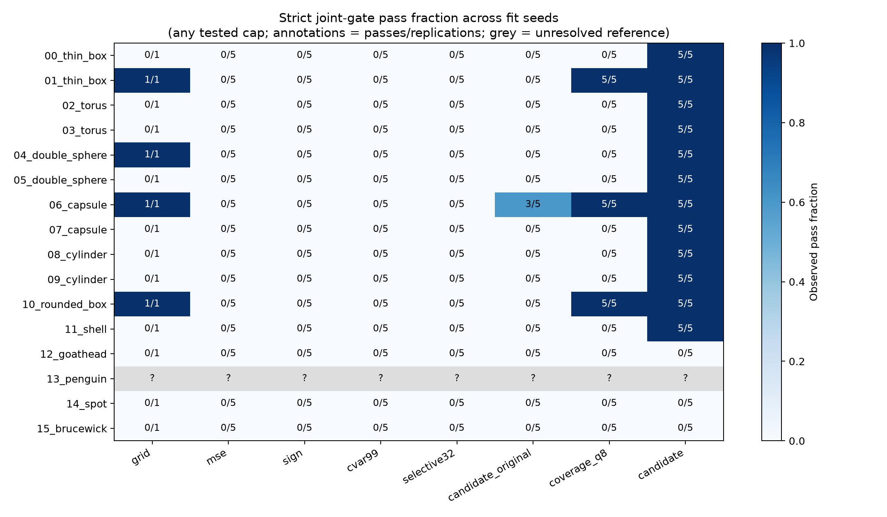
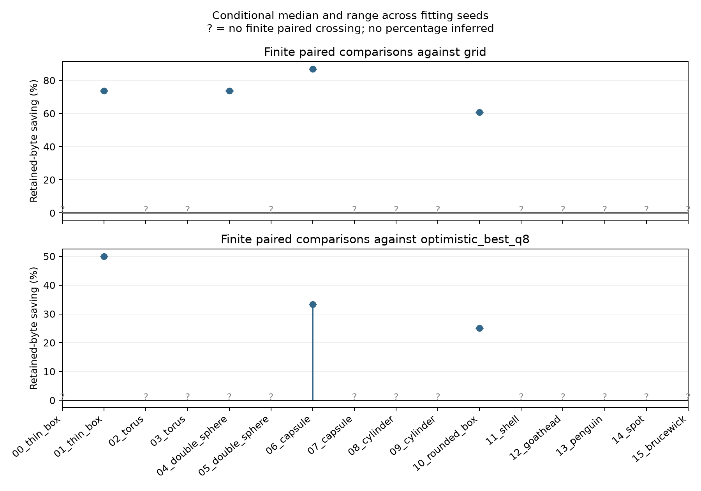
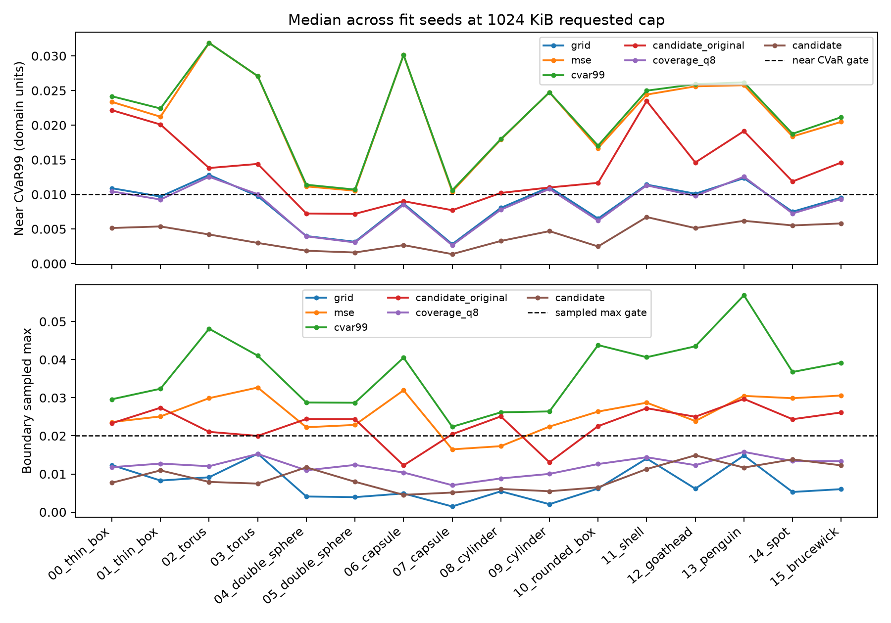
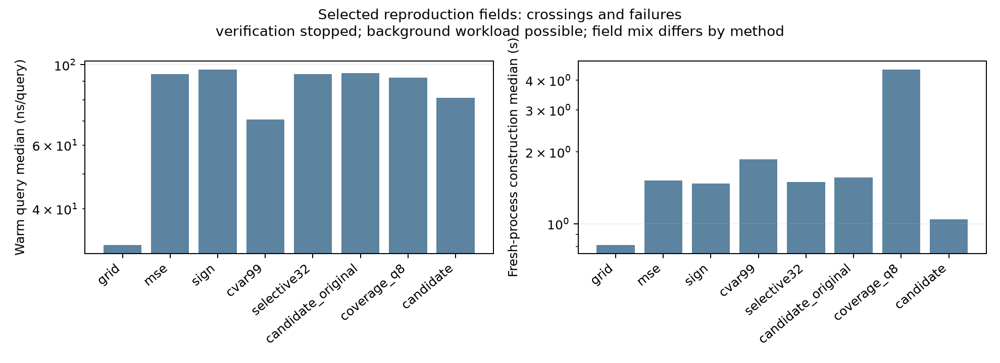
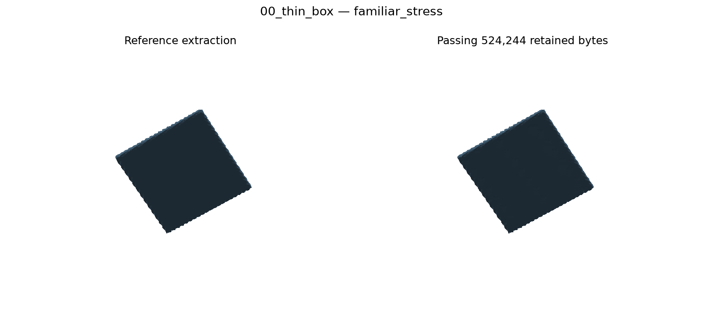
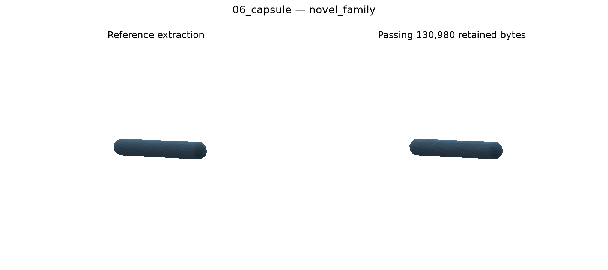
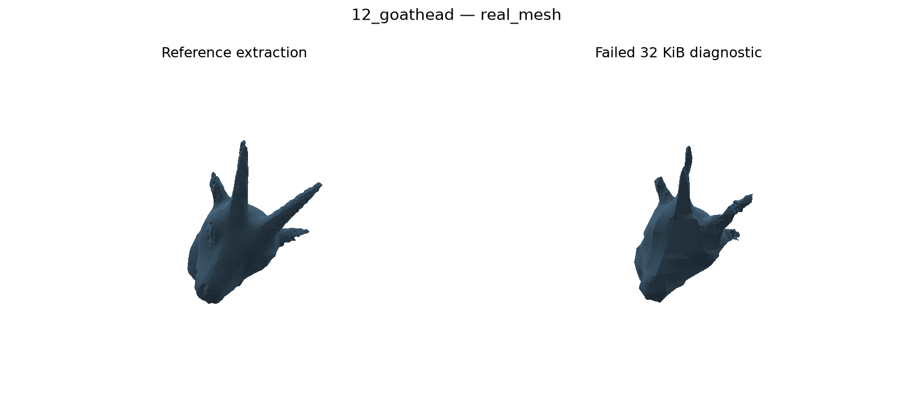

# Frozen generalization v1 results

Observed lower retained-byte crossings: 20/80 seed cases against grid and 13/80 against the strongest tested q8 envelope. Five seed cases share an unresolved reference geometry and cannot certify a pass. Conditional successes, censored cases and failures are shown separately; five fit seeds are replications, not independent shapes.

Positive comparisons on novel analytic families, at tested passing caps with finite crossings and strictly fewer bytes against both comparators: 06_capsule: 3/5 seeds; 10_rounded_box: 5/5 seeds. This evidence is specific to these instances. Ties, censored comparisons, real-mesh limitations and unresolved Penguin remain part of the study.

Defensible CV wording: “Implemented and independently verified an adaptive q8 SDF representation using 25.0% less retained field storage than the strongest tested q8 baseline on a held-out rounded box across five fitting seeds, while passing frozen distance, dimension, feature and topology gates.” This refers to one rounded-box instance at a tested passing cap. The held-out capsule had three seed gains and two ties against q8; all three reference-qualified real meshes failed the joint gates, and Penguin's reference topology remained unresolved.

Independently verified 7,488 fields in 576 jobs and 2,617,612,152 decoded query evaluations. A separately rebuilt source snapshot reproduced 116 selected crossings and adjacent/censored failures exactly.

| Geometry | Stratum | Candidate seeds passing | Common candidate cap | Grid cap | Strongest q8 crossings |
|---|---|---:|---:|---:|---|
| 00_thin_box | familiar_stress | 5/5 | 512 KiB | censored | censored |
| 01_thin_box | familiar_stress | 5/5 | 256 KiB | 1024 KiB | 524,244–524,244 bytes (5/5) |
| 02_torus | familiar_stress | 5/5 | 256 KiB | censored | censored |
| 03_torus | familiar_stress | 5/5 | 512 KiB | censored | censored |
| 04_double_sphere | familiar_stress | 5/5 | 256 KiB | 1024 KiB | censored |
| 05_double_sphere | familiar_stress | 5/5 | 1024 KiB | censored | censored |
| 06_capsule | novel_family | 5/5 | 128 KiB | 1024 KiB | 130,980–196,500 bytes (5/5) |
| 07_capsule | novel_family | 5/5 | 192 KiB | censored | censored |
| 08_cylinder | novel_family | 5/5 | 192 KiB | censored | censored |
| 09_cylinder | novel_family | 5/5 | 256 KiB | censored | censored |
| 10_rounded_box | novel_family | 5/5 | 192 KiB | 512 KiB | 262,020–262,020 bytes (5/5) |
| 11_shell | novel_family | 5/5 | 512 KiB | censored | censored |
| 12_goathead | real_mesh | 0/5 | censored | censored | censored |
| 13_penguin | real_mesh | unresolved | unresolved | unresolved | unresolved |
| 14_spot | real_mesh | 0/5 | censored | censored | censored |
| 15_brucewick | real_mesh | 0/5 | censored | censored | censored |

Crossings are the smallest **tested actual retained bytes** passing every gate, not exact minima. Common caps require all fitting seeds to pass at that requested cap. There is no interpolation or monotonicity assumption. A missing crossing through 1,024 KiB does not prove a continuous minimum above that ceiling. No finite or percentage saving is calculated for a censored comparator.

The strongest q8 envelope includes MSE, sign, finite-threshold CVaR, selective K32, the original candidate, and the stronger p08 coverage-only depth-six control. It is an optimistic post-evaluation envelope, not a deployable selection policy.

| Stratum | Finite strongest-q8 comparisons | Lower-memory cases | Conditional median saving | Range |
|---|---:|---:|---:|---|
| familiar_stress | 5/30 | 5 | 50.0% | 50.0% to 50.0% |
| novel_family | 10/30 | 8 | 25.0% | 0.0% to 33.3% |
| real_mesh | 0/20 | 0 | unobserved | unobserved |

These conditional percentages exclude censored cases and are not population generalization estimates. Per-baseline paired results, per-seed ranges, common caps and higher-cap failures are retained in CSV files.

Retained storage includes the 64-byte packed or 64-byte grid object plus its complete buffer, including descriptors and q8 payloads. Oracle objects, fit/reference labels, shared caches, construction scratch, allocator overhead and disk evidence are excluded. Across the serial sweep, 325,042,976 logical oracle requests used 23,775,387 physical evaluations; other requests were exact-coordinate cache hits.

Main-sweep timing files are serial measurements under concurrent independent validation load. They are retained as raw evidence and do not support comparison claims. Isolated-timing.csv uses the separately rebuilt frozen source after validation workers stopped, covering every method, both analytic strata and every accepted real mesh. It records nine warm query repeats and cold construction without shared labels. The construction path builds a maximum 1 MiB frontier, so it is an upper-bound isolated path for a selected smaller-cap field, not an optimized isolated per-cap time. CVaR remains cap-specific.

Strict gates include all saved evaluation-set sampled maxima, both signs in every feature group, every signed measurement-ray interval, per-group widths and both qualified manifold/component-Euler controls. Skipped extraction is separate from observed topology failure. Sampled maxima are not continuous worst-case certification. Penguin remains oracle_resolution_unresolved through 192 cells.

VERIFIER_CORRECTION.json records enforcement of the already-frozen per-ray endpoint and ordered-midpoint sign predicate. Native width flags and fields were preserved; corrected acceptance is separate. The reversed-sign/same-roots/same-width regression passes, and full-count development confirmation still passes all five familiar cases under the corrected predicate. Verification caches bind the frozen hash, job hash and corrected evaluator/helper versions.

Meshes use the explicitly audited EPICK rounded-construction oracle after unchanged EPECK geometric validation. Per-mesh sampled comparisons show maximum distance differences at most 3.89e-16, below 1e-10, plus independent brute-force distances and ray-parity signs. This is not a global exact-construction guarantee. Wingnut was rejected before final fitting and replaced by public-domain Spot; inputs and rejection logs remain. Individual upstream attribution/licenses and original-unit transforms are in FROZEN.json; Brucewick is CC BY-NC 4.0 research use.

Artifacts are in runs/generalization-v1: immutable source/, FROZEN.json, reference/ and reference-fast/, binary jobs/, verification/, reproduction/, oracle-audit/ and shared-cache/. Compact results and figures are in docs/generalization-v1. The frozen protocol is docs/generalization-protocol.md.

| Method | Isolated fields | Warm query median (ns/query) | Range | Cold build median (s) | Range |
|---|---:|---:|---:|---:|---:|
| grid | 12 | 31.8 | 30.4–49.4 | 0.815 | 0.004–1.764 |
| mse | 12 | 94.1 | 90.0–119.6 | 1.517 | 0.118–2.191 |
| sign | 12 | 96.8 | 92.1–101.2 | 1.472 | 0.118–2.184 |
| cvar99 | 12 | 70.6 | 64.1–82.9 | 1.861 | 0.383–2.505 |
| selective32 | 12 | 94.1 | 91.9–101.8 | 1.492 | 0.128–2.170 |
| candidate_original | 12 | 94.7 | 76.4–102.1 | 1.564 | 0.147–2.219 |
| coverage_q8 | 12 | 92.0 | 79.6–105.5 | 4.420 | 0.663–5.603 |
| candidate | 32 | 81.1 | 68.1–111.1 | 1.045 | 0.996–7.694 |

The isolated field mix contains crossings and adjacent or censored failures; these aggregates describe that selected mix, not an equal-accuracy speedup. Grid construction is measured in a fresh process with only its selected cap. Adaptive construction uses the cold maximum-frontier path; its smaller-cap construction figure is an upper-bound path. The nine-repeat query maximum is retained explicitly, and all phase/request counts are in isolated-timing.csv. These are fresh-process timings with this study's verification stopped. An unrelated compute worker was present in another workspace; an idle-machine or exclusive-host claim is not made.

| Method | Fields | Joint passes | Scalar rejects | Feature rejects | Width rejects | Observed topology failures | Skipped topology |
|---|---:|---:|---:|---:|---:|---:|---:|
| grid | 208 | 5 | 201 | 88 | 117 | 0 | 203 |
| mse | 1040 | 0 | 1040 | 373 | 548 | 0 | 1040 |
| sign | 1040 | 0 | 1040 | 334 | 518 | 0 | 1040 |
| cvar99 | 1040 | 0 | 1040 | 369 | 609 | 0 | 1040 |
| selective32 | 1040 | 0 | 1040 | 373 | 622 | 0 | 1040 |
| candidate_original | 1040 | 14 | 1026 | 326 | 586 | 0 | 1026 |
| coverage_q8 | 1040 | 45 | 976 | 413 | 578 | 0 | 995 |
| candidate | 1040 | 179 | 817 | 365 | 586 | 0 | 861 |

Gate rejection counts overlap. The full matrix preserves sampled maxima/tails, worst width-group mean and p95, every native/corrected flag and topology status; unresolved reference rows are separate from representation failures.

Construction figures sum fit labeling, tree/refinement and coverage labeling, loss recomputation, allocation and packing. Sample/rank evidence writes inside the labeling and tree timers are included. Oracle object setup/input validation, outer field/prediction writes, evaluation labels and surface extraction are excluded. Raw oracle-audit scopes are recorded separately and their unequal EPECK/EPICK timing scopes are not used as a speed ratio. Warm query batches exclude oracle calls, file writes and surface extraction.

The kernel precision distinction follows [CGAL's EPICK reference](https://doc.cgal.org/6.2/Kernel_23/classCGAL_1_1Exact__predicates__inexact__constructions__kernel.html): exact geometric predicates with generally inexact constructions. Distance queries follow the [CGAL AABB-tree documentation](https://doc.cgal.org/latest/AABB_tree/); inside/outside sign is computed separately.

