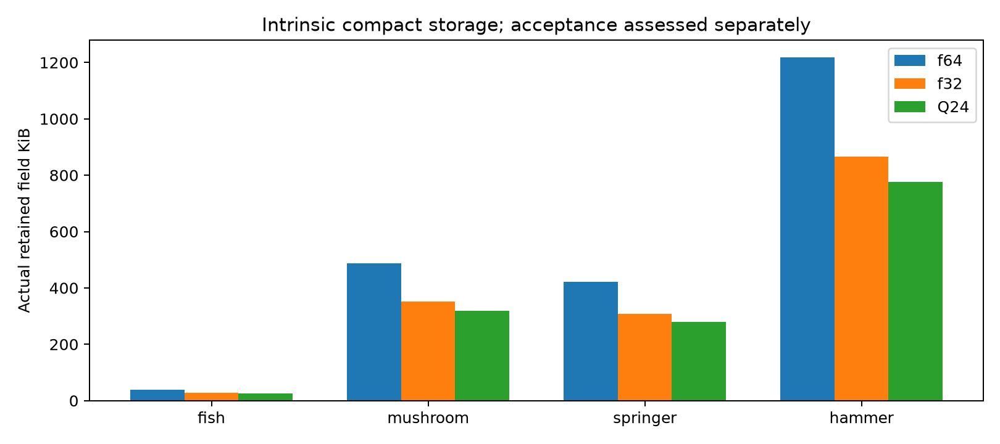
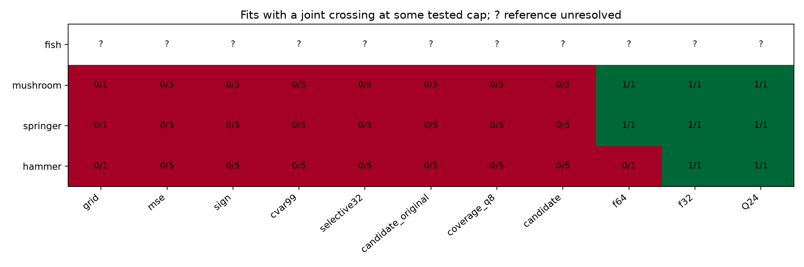
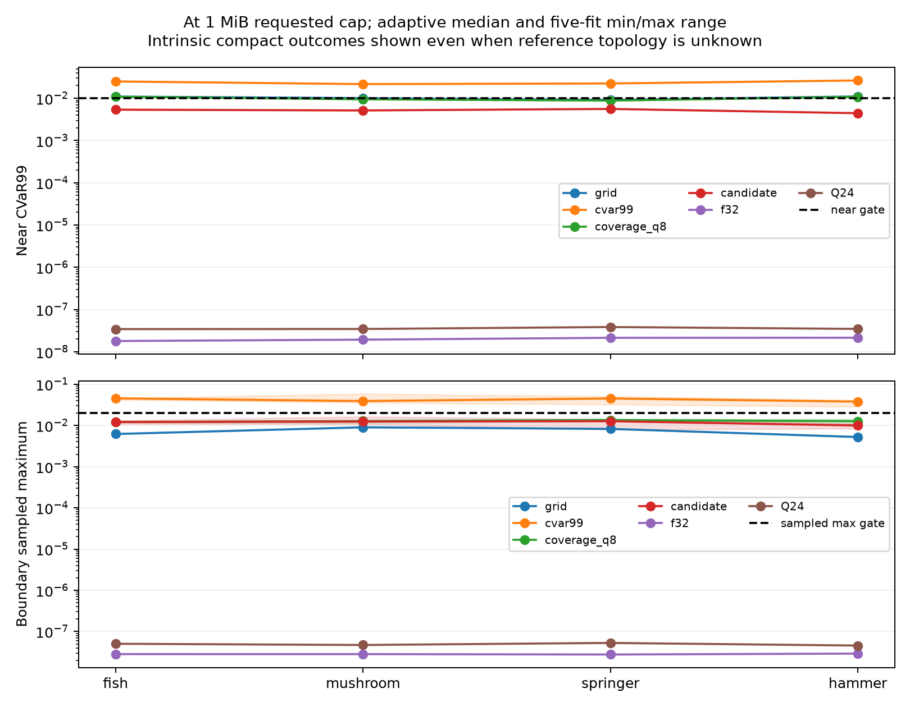
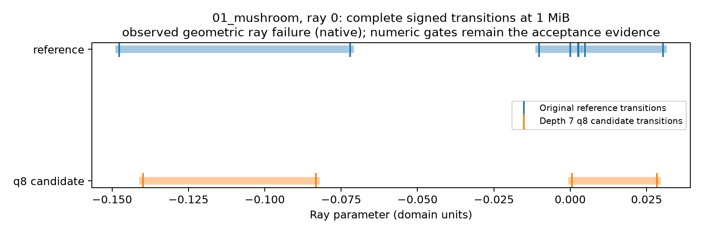
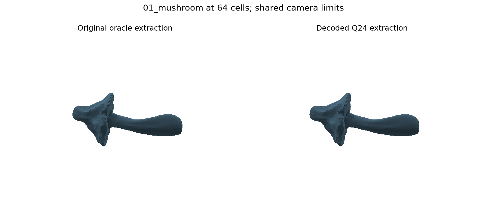
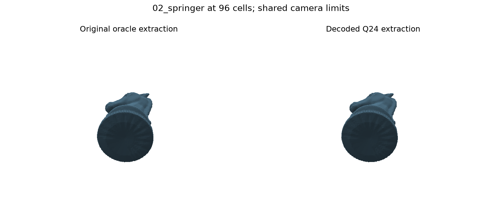
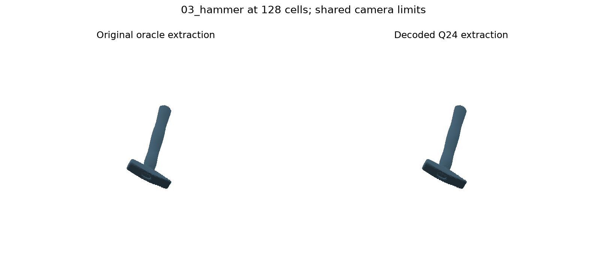

# Frozen held-out compact mesh study
Q24 has a joint crossing on 3 of 3 reference-qualified held-out meshes; the declared suite contains 4 meshes. Reference-unresolved inputs remain unknown in the matrix.
The candidate stores shared quantized vertices, every triangle, codec metadata and its own conservative BVH. It queries only decoded geometry. This is a representation-family comparison, not improved q8 interpolation.
2,028 logical cap rows and 156 physical jobs; 1,884 physical encoded-field records: twelve deterministic compact records, 52 grid records and 1,820 adaptive cap records. Different cap records may have identical binary content. One detached Fish f64 boundary attempt was preserved and exactly reproduced; 156 expected jobs therefore involve 157 fresh construction attempts, including that procedural rerun. Compact fields have an intrinsic size and are reused at every feasible cap; fitting variation applies only to the adaptive baselines.
All frozen scalar, feature, signed-ray dimension and two-resolution extraction gates remain mandatory. Sampled maxima are not continuous worst-case certification.

| Held-out mesh | Reference levels | Q24 bytes at a tested passing cap | Strongest passing compact control | Saving |
|---|---|---:|---:|---:|
| 00_fish | unresolved | no joint crossing | no finite comparison |  -  |
| 01_mushroom | 64,96 | 325380 | 360084 | 9.64% |
| 02_springer | 96,128 | 285500 | 314508 | 9.22% |
| 03_hammer | 128,192 | 795736 | 885932 | 10.18% |

The optimistic per-case q8 and compact envelopes are separate comparisons, not deployable selection policies. No finite or percentage saving is computed when either field has no observed joint crossing. The minimum is the smallest tested actual retained bytes; accuracy need not be monotonic across caps.

Retained storage includes the 88-byte owning query object and complete serialized buffer, including padding. Original meshes, CGAL oracles, temporary construction buffers, allocator overhead and query scratch are excluded; construction and total benchmark peak memory are recorded separately.
Nine serial warm compact batches use 4,096 uniform sites; adaptive/grid native batches use 100,000. No cross-family timing ratio is asserted from these different scopes. Source loading, original validation, encoding, decoded validation, extraction, oracle labels and ordinary queries are recorded separately. Host background load is uncontrolled.

Each accepted codec passes decoded orientation, cyclic vertex links, nondegeneracy, domain containment, component topology and EPECK self-intersection validation. Independent verification decodes every byte, checks exact f64/XOR geometry identity, lossy displacement, BVH coverage/bounds, all scalar metrics and every ray event; stratified brute-force decoded-triangle queries are a separate subset, not a second full 200,000-query oracle.

[Full 2,028-row matrix](matrix.csv), [full crossings](crossings.csv), [paired comparisons](paired_savings.csv), and [frozen provenance](FROZEN.json). The local binary evidence is retained under `runs/generalization-v2/fresh-v2`.

Input attribution: Fish - Keenan Crane, public domain; Mushroom - Josh Holinaty, CC BY-NC 4.0; Springer - Tim Edwards, GPLv2; Hammer - Andrea Spognetta, CC BY 4.0. Source revision 835213277571d625722d25880c9c3010c6f45a5a. Exact individual README text, URLs, hashes and transforms are frozen.

Across 3 independent qualified meshes with finite compact comparisons, median retained-storage saving is 9.64% (range 9.22–10.18%).
These named held-out meshes are not a population estimate. Fish is reference-unresolved and excluded from joint-crossing denominators. Compact/grid comparisons are emitted once; q8 paired rows vary across five independent fitting seeds.

The preserved diagnosis explains the representation change: depth 12 unquantized trilinear interpolation loses a short Brucewick interval. Q24 explicitly retains triangles, requires a closed triangle-mesh input and carries a measured query-cost tradeoff. It is not a q8 allocation/interpolation breakthrough. Earlier sphere-gap and tail-regression results remain separate.

The 1,884 encoded-field records contain 1,568 distinct binary content hashes. Verification covers 156 physical jobs and 2,028 logical cap rows; baseline logical prediction/objective evaluations total 654,613,872, and compact independent decoded-distance/sign subset queries total 11,664; the preserved VERIFIED key mixes both scopes.
[Failure-gate counts](failure_gates.csv) distinguish skipped topology, observed failure, numerical uncertainty and unresolved reference. [Phase/query costs](costs.csv) and [peak memory](peak_memory.csv) keep construction and total process scopes separate; baseline construction-only peaks are unavailable. CVaR allocation work is summed across all caps; other adaptive rows export combined maximum-frontier and per-cap allocation time, so the maximum combined phase is counted once and cannot be fully separated. Original fitting-label time is added; baseline oracle setup is not separately timed and remains in total process time. No cross-family construction ratio is inferred.

Verification/reproduction identities are bound to the original frozen SHA and full verified manifests. Reproduction uses separately rebuilt frozen source with study verification stopped, retaining exact fields, predictions, flags, complete ray events/witnesses and surfaces or decoded-rejection outcomes.

| Mesh | Field | Build/validate seconds | Warm query median microseconds | Construction cumulative peak MiB |
|---|---|---:|---:|---:|
| 00_fish | f32 | 0.173 | 137.45 | 6.25 |
| 00_fish | Q24 | 0.209 | 152.06 | 6.22 |
| 01_mushroom | f32 | 2.143 | 341.23 | 15.45 |
| 01_mushroom | Q24 | 2.571 | 367.63 | 15.01 |
| 02_springer | f32 | 2.640 | 314.03 | 13.79 |
| 02_springer | Q24 | 2.184 | 318.69 | 14.41 |
| 03_hammer | f32 | 5.469 | 983.57 | 30.90 |
| 03_hammer | Q24 | 6.499 | 1082.09 | 30.56 |

Both compact query columns use identical 4096-site, nine-batch scopes; construction includes source load, encoding/BVH/packing and mandatory decoded validation, excluding the evaluation oracle/extraction. Peaks are cumulative process high-water marks through decoded validation.

Frozen-source reproduction completed 44 fresh-process jobs, including every contributing fitting-seed crossing and adjacent smaller tested cap or censored endpoint.

<!-- v2-publication -->
On the three reference-qualified fresh meshes, Q24 used 9.64% less retained field storage at tested passing caps than the strongest passing compact control (f32); the per-mesh range was 9.22% to 10.18%. The declared held-out suite contained four meshes: Fish remained reference unresolved. All frozen sampled-distance, feature, signed-ray dimension and two-resolution extracted-topology gates were required.

The candidate stores explicit triangles from the source mesh with shared quantized vertices and its own BVH. This changes the representation family and input requirement; it is not a q8 allocation/interpolation breakthrough. The old-mesh diagnostic found a missed Brucewick interval even in depth-12 unquantized trilinear interpolation. Adaptive/grid comparators without a joint crossing through 1 MiB stay censored, with no invented percentage saving. Compact ordinary queries cost more than interpolation; batch sizes differ across families, so no cross-family speed ratio is claimed.

[Complete compact metrics, feature recalls, dimensions, displacement and section accounting](compact-assessments.json) | [Current commands](../commands.md)

## Matched compact query variation

Main sweep: microseconds/query across nine serial batches of the same 4,096 uniform sites per field. The range is repeated-batch variation on this host, not independent shape variation or an idle-machine confidence interval.

| Mesh | Field | Median | Minimum | Maximum |
|---|---|---:|---:|---:|
| 00_fish | f32 | 137.45 | 135.75 | 139.81 |
| 00_fish | Q24 | 152.06 | 150.63 | 162.60 |
| 01_mushroom | f32 | 341.23 | 337.21 | 351.17 |
| 01_mushroom | Q24 | 367.63 | 364.90 | 373.76 |
| 02_springer | f32 | 314.03 | 296.93 | 343.21 |
| 02_springer | Q24 | 318.69 | 315.61 | 323.10 |
| 03_hammer | f32 | 983.57 | 977.41 | 1008.99 |
| 03_hammer | Q24 | 1082.09 | 1077.18 | 1098.68 |

[All 144 main-sweep and source-reproduction matched compact batches](compact_query_batches.csv) are labelled by phase and source-file hash. Source reproduction retains a separate fresh-process timing observation; deterministic equivalence does not imply equal host timings. Adaptive/grid batches use 100,000 sites, so these tables support no cross-family speed ratio.

[Evidence completion and final QA](../COMPLETION-2026-10-12.md) | [Rebuild provenance and preserved test-input exception](REBUILD-PROVENANCE.json) | [Hashed unchanged v1 test-fixture supplement](REBUILD-TEST-FIXTURES.json)
