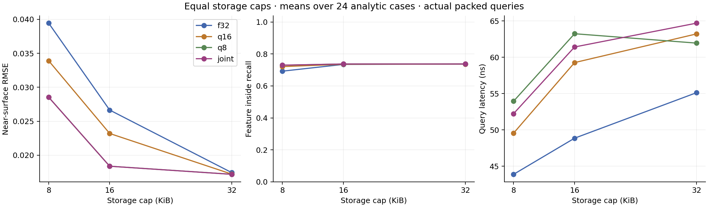
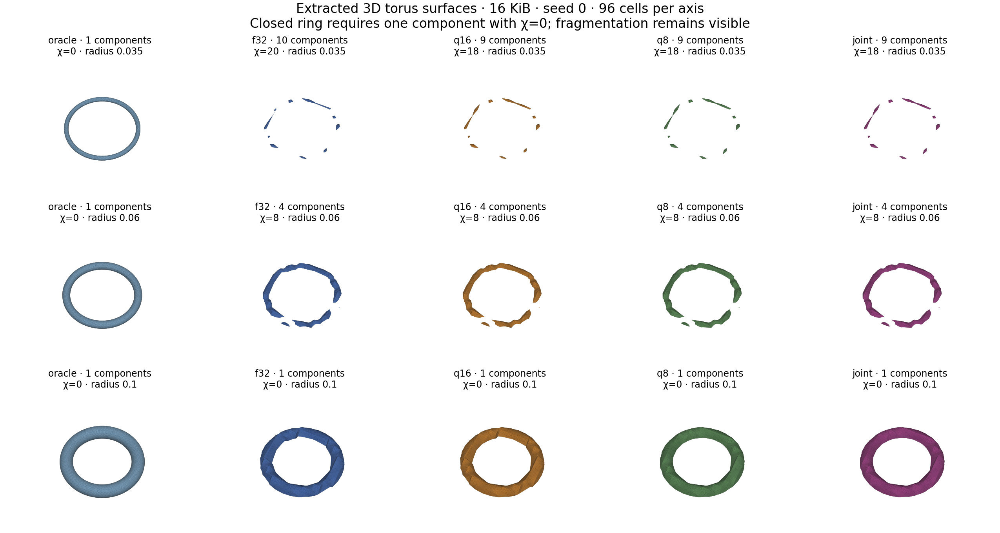

# Joint spatial and numerical precision study

Implemented and evaluated on 8 October 2026. **Compressed leaves buy useful
spatial resolution, but joint precision selection barely improves on fixed
8-bit storage in this sweep.** The exact reference is useful evidence of that
limit rather than a reason to claim a large allocation gain.

## Implementation

The C++ implementation provides float32, locally quantized unsigned 16-bit and
8-bit corners; an executable tagged-offset packed field; and exact tree
knapsack allocation over spatial subdivisions and encoding choices. All four
baselines use the same compact layout. On this build, retained storage is a
64-byte query object plus four bytes per internal node and 36/28/20 bytes per
f32/q16/q8 leaf, including tags, scale, offset and alignment. No internal corner
values are retained. Temporary construction memory is excluded.

The DP convolves child cost/loss frontiers and removes dominated states without
cost approximation. It minimizes fitting SSE within the fixed depth-four tree,
not evaluation error or topology. The [frozen protocol](precision-protocol.md)
defines all success criteria, distributions, storage rules and limitations.
Variable-precision volume storage already exists in
[NanoVDB](https://www.openvdb.org/documentation/doxygen/tools_2CreateNanoGrid_8h_source.html);
this implementation investigates joint allocation and its measured value.

## Equal-byte results

The run covers 288 fields: three translated analytic shapes, four feature sizes,
two fitting seeds, three budgets and four policies. Each case uses 4,096 fitting
samples and independent sets of 32,768 uniform and 32,768 near-surface queries.
Numbers below average cases equally; timings are means of per-field batch
medians on one MSVC Release build.

| At 16 KiB | Float32 | Fixed q16 | Fixed q8 | Joint |
|---|---:|---:|---:|---:|
| Near-surface RMSE | 0.026647 | 0.023197 | 0.018377 | 0.018375 |
| Uniform RMSE | 0.025131 | 0.019899 | 0.012705 | 0.012703 |
| Inside probe recall | 73.47% | 73.55% | 73.73% | 73.73% |
| Outside probe recall | 84.51% | 84.21% | 82.10% | 82.10% |
| Query ns | 48.86 | 59.27 | 63.25 | 61.42 |

Joint reduces near RMSE by **31.0% versus float32**, but only **0.015% versus
fixed q8** at 16 KiB. Better SSE does not imply better exterior signs: outside
recall decreases. At 32 KiB, joint uses 37,584 q8 leaves, 408 q16 leaves and zero
f32 leaves across all cases. Its near RMSE is only 1.47% below float32 there.



The predeclared combined accuracy target (near RMSE <=0.02 and both probe
recalls >=95%) is reached in the same 10 of 24 cases by each method. Float32
needs a tested cap of 32 KiB for all ten; q8 and joint need 16 KiB. The remaining
14 cases never meet the target at the tested caps. These are discrete observed
budget crossings, not exact minimum-byte guarantees.

Mean shared candidate generation is 5.45 ms. The maximum-budget DP, reused for
all three caps, averages 6.53 ms for f32, 6.18 ms for q16, 5.57 ms for q8 and
**134.90 ms for joint**. Joint backtracking and packing take 0.07–0.18 ms.
At 32 KiB, joint queries take 64.70 ns versus 56.17 ns for a float32 copy of
the same topology: **8.53 ns / 15.2% additional latency**. This diagnostic also
changes payload footprint and cache behavior; it is not a pure instruction-level
decoder measurement. Serial repeats do not establish machine-level uncertainty.

## Minimum recoverable geometry

All fields and oracle controls were extracted as indexed 3D triangle meshes at
32, 64 and 96 cells per axis: 936 extractions, with all 312 finest meshes saved
as OBJ. Tests check connected components, Euler characteristic, edge incidence
and vertex links, plus the independent sign probes. Success requires both
final resolutions, both seeds, and success at every larger tested feature.

* **Wall:** minimum tested half-thickness 0.035 (full thickness 0.07) for every
  method and budget. Compression does not lower this threshold.
* **Torus:** minimum tested tube radius 0.10 (diameter 0.20). At 8 KiB, q16,
  q8 and joint pass while f32 fails. At 16/32 KiB all methods pass at 0.10;
  no method passes at 0.06 or below.
* **Two spheres:** minimum tested gap 0.10. q8 and joint pass at 8 KiB; f32
  and q16 first pass at 32 KiB. No method recovers the smaller tested gaps
  under the full success criterion.



The smallest oracle torus (radius 0.02) and sphere gap (0.02) fail at 64 cells
but succeed at 96, so their extraction remains resolution-limited under the
predeclared two-resolution rule. For larger thin tori the oracle succeeds while
the packed field fragments, identifying a field failure at the tested grids.
Adaptive leaves can be discontinuous: topology describes the sampled extraction,
not a proof about the continuous field. Depth four limits available spatial
resolution regardless of how cheaply corners are stored. A deeper-candidate
experiment would require a new protocol, not retrospective tuning of this run.

## Reproduction and checks

```powershell
cmake -S . -B build-core -DSDF_WITH_CGAL=OFF
cmake --build build-core --config Release --parallel 4
ctest --test-dir build-core -C Release --output-on-failure
python scripts/precision_evidence.py runs/precision-new --run --exe build-core/Release/sdf_precision_bench.exe --archive runs/precision-new-archive
python scripts/precision_evidence.py runs/precision-new-archive --verify-archives
# Optional scientific plots: Python with numpy and matplotlib
python scripts/precision_plots.py runs/precision-new runs/precision-new-archive
```

All three local suites pass, including **25,578 precision/surface checks**:
exhaustive 3^8 leaf-encoding enumeration with randomized losses, byte boundaries,
constant/negative values, independent packed SSE, joint-versus-fixed inequalities,
and analytic sphere/torus/wall/two-component surface checks. A separate Python
reader reconstructs the fitting SSE of every one of the 288 raw byte buffers,
checks complete byte coverage, selected encoding losses, and storage caps.
CI includes the precision smoke run; remote CI has not been observed.

The [report](precision-v1/report.html), [summary](precision-v1/summary.csv),
[recovery thresholds](precision-v1/recovery.csv), and
[accuracy crossings](precision-v1/accuracy_crossings.csv) are directly readable.
The evidence ZIP and three mesh ZIPs preserve all samples, selected nodes,
candidate losses, packed buffers, timing repeats, meshes, the pre-run source and
executable, and SHA-256 manifests. The split archives keep each file below
100 MB. Verify the publication with:

```powershell
python scripts/precision_evidence.py docs/precision-v1 --verify-archives
```

This implements upgrades 1 and 3. CVaR99 is measured here but is not the
allocation objective. The subsequent [fixed-q8 tail study](tail-study.md)
implements direct CVaR99 allocation and checks its geometric limits.
