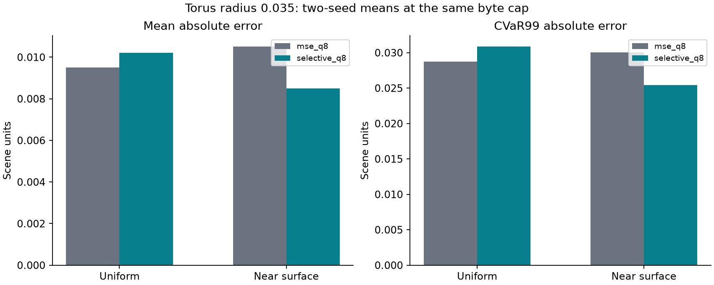
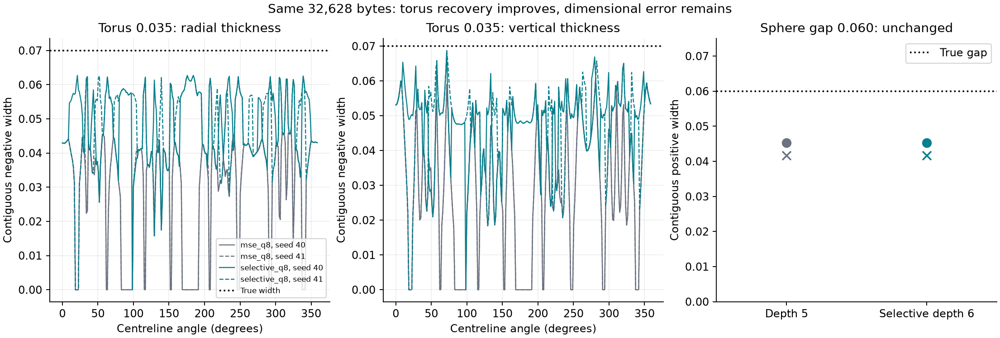

# Selective depth six recovers a smaller torus within 32 KiB

Measured 8 October 2026. **Torus radius 0.035 is recovered at 32,628 bytes** on
both fresh seeds, with q8 and the MSE objective unchanged. The depth-five
baseline recovers only down to the tested radius 0.060. All larger torus controls
pass. The sphere gap 0.060 is still unrecovered; its larger 0.100 control passes.

[Report, plots and complete tables](refinement-v1/index.html) ·
[Predeclared protocol and frozen selection](refinement-protocol.md)

## A fitting-only rule, chosen before evaluation

Start from the existing complete depth-five tree. Rank its occupied terminal
cells by the sum of squared **decoded q8 fitting residuals**, normalized by
domain scale squared; break ties by node index. Add all eight depth-six children
to the top K positive-loss parents. Keep all original depth-five options and
use the same exact q8 MSE tree knapsack at 32,768 bytes. The candidate set grows;
the final allocation decides which deeper splits are worth retaining.

Development uses torus/sphere-gap sizes 0.03/0.08, seeds 201/202 and 10,000 fitting
points per case. No evaluation samples or probes are generated. Compare
K=32/64/128/256/512/1024 and select the smallest whose allocated fitting SSE is
within 1% on average and 5% in every case of K=1024. **K=32 qualifies**, at
0.1713% mean and 0.8653% maximum excess. K>=64 matches the reference fitting
optimum. All 56 development allocations and the selection hash are retained.
The rule was frozen before running evaluation and was not retuned afterward.

Final evaluation pairs seeds **40/41**, 10,000 fitting samples (50/50
uniform/near) and 100,000 fresh queries per evaluation distribution. Near noise
is feature/2. The original translation, probes and geometry rules are unchanged.
These are familiar analytic shapes with fresh samples, not unseen-shape tests.

## Recovery and all larger controls

Each entry requires the original >=95% inside/outside probe recalls, closed
manifold and expected component Euler values at **both 64 and 96 extraction
cells**, matching oracle controls, both seeds, and success at every larger
tested feature. The 32-cell diagnostic is also retained. Every required
topology/oracle check passes; target failures below are sign-probe failures.

| Shape / feature | Depth-five baseline | Selective depth six | Relevant recall, seed 40 / 41 |
|---|---|---|---|
| Torus 0.035 | Fail | **Pass** | 80.08% / 80.08% → **99.61% / 98.44%** inside |
| Torus 0.060 | Pass | Pass | 100% / 100% inside, both methods |
| Torus 0.100 | Pass | Pass | 100% / 100% inside, both methods |
| Sphere gap 0.060 | Fail | Fail | 68.75% / 68.75% outside, unchanged |
| Sphere gap 0.100 | Pass | Pass | 95.31% / 95.31% outside, unchanged |

The complementary probe class is 100% throughout. The minimum **tested**
recovered torus radius improves from **0.060 to 0.035**; the sphere-gap minimum
remains **0.100**. No smaller features were tested in this focused comparison.

Both torus target seeds retain all **32/32** proposed deeper splits. The 0.060
torus retains 3 and 4; the 0.100 torus and both sphere-gap sizes retain none.
Every final field occupies exactly **32,628 bytes**, leaving 140 bytes below
the cap. A q8 split costs 144 bytes, so the remaining space cannot buy another.
The target torus spends 4,608 bytes on the 32 deeper splits by giving up the
same number of splits elsewhere; total storage remains unchanged.

A post-evaluation localization check finds 50/51 and 47/51 baseline torus
failures inside the selected depth-five cells. All **40/40** failed gap probes
per seed also lie inside selected cells, but their deeper splits are rejected
by the MSE allocation. The gap's selective and baseline buffers are byte-for-byte
identical. This diagnoses the frozen candidate/allocation result; it does not
prove that no other MSE candidate policy can recover the gap. These probes were
used only after evaluation for explanation, never to choose cells or K.

## Error and construction cost alongside recovery

Means across the two paired seeds. Errors are in scene units. Every row uses
32,628 actual bytes, including the 64-byte query object and packed buffer.
CVaR99 averages the largest 1,000 absolute errors per 100,000-query distribution.

| Target | Method | Uniform MAE / CVaR99 | Near MAE / CVaR99 | Oracle calls | Total build ms |
|---|---|---:|---:|---:|---:|
| Torus 0.035 | d5 baseline | 0.009512 / 0.028758 | 0.010505 / 0.030022 | 309,592 | 68.25 |
| Torus 0.035 | selective d6 | 0.010201 / 0.030848 | 0.008489 / 0.025435 | 311,640 | 70.93 |
| Gap 0.060 | d5 baseline | 0.009770 / 0.025730 | 0.006848 / 0.017407 | 309,592 | 55.68 |
| Gap 0.060 | selective d6 | 0.009770 / 0.025730 | 0.006848 / 0.017407 | 311,640 | 62.10 |

For the target torus, near MAE improves **19.19%** and near CVaR99 **15.28%**;
uniform MAE worsens **7.25%** and uniform CVaR99 **7.27%**. These percentages
compare two-seed means. The report includes every control, per-seed values and
paired deltas. This is a local recovery gain with a global-error tradeoff.



The candidate count grows from 37,449 to 37,705. Thirty-two parents add 256
children and **2,048 corner oracle calls**, a 0.662% increase including fitting
labels. Total construction includes fitting labels, full d5 construction and
encoding/loss, residual selection, d6 corner queries/encoding/loss, DP and
packing. It excludes evaluation, mesh extraction and evidence writing. Both
builds use the existing three-encoding temporary container; retained fields
use q8 only. Duplicate corner calls count separately. Two serial Release
measurements are descriptive timings, not a performance confidence interval.
No temporary/peak-memory reduction is claimed.

## Recovered widths still differ substantially from truth

Torus widths are contiguous negative intervals around the analytic centreline
at 256 angles. Sphere width is the positive interval around the gap midpoint.
The existing feature/2048 scan and 40 bisections are unchanged. Wrong centre
sign produces width zero; missing brackets remain missing. No bracket failures
occurred. Adaptive transitions may be discontinuities rather than continuous
roots. Analytic oracle widths reproduce truth within 1e-12.

| Target width diagnostic | Truth | d5, seeds 40 / 41 | selective d6, seeds 40 / 41 |
|---|---:|---:|---:|
| Torus median radial thickness | 0.070 | 0.03649 / 0.03661 | **0.04789 / 0.04817** |
| Torus median vertical thickness | 0.070 | 0.03098 / 0.03098 | **0.05035 / 0.05037** |
| Torus zero-width angles, each axis | 0 | 51 / 51 | **1 / 4** |
| Sphere gap axis width | 0.060 | 0.04529 / 0.04165 | 0.04529 / 0.04165 |



The torus median thickness remains about **31% too small radially** and **28%
too small vertically**. Passing the frozen sign/topology rule therefore does
not imply dimensional fidelity. Widths supplement the original recovery rule;
they were not used to replace or relax it.

## Validation and reproduction

All four C++ suites pass, including new checks for residual ranking, unchanged
old losses, child sample routing/loss, nested candidate optimality, byte caps,
oracle counts, zero selection, zero-residual cells and repeated/invalid calls.
The existing full depth-six candidate-tree rejection remains in place; only
the explicit selective extension can add these candidates.

An independent NumPy decoder verifies all **4,207,184 saved C++ queries** across
20 fields, oracle labels, MAE/CVaR99/recalls, allocated fitting SSE, complete
packed byte coverage, q8 encoding and depth/cap limits. An independent residual
calculation reproduces all selected-parent ranks, boxes and sample counts and
checks retained branches, candidate/oracle counts and summed construction costs.
Recovery aggregation checks both seeds, required resolutions, oracle controls
and every larger feature. C++ surface checks assess per-component Euler values.

Raw data and pre-run source/executable snapshots have SHA-256 manifests. The
compact report includes analysis/report source snapshots and its own manifest.
`runs/refinement-v1-analysis-02` is the canonical analysis; the initial successful
analysis is retained, and the second adds a complete analysis-file hash manifest.
No model or allocation settings changed between those verification passes.

```powershell
cmake -S . -B build-core -DSDF_WITH_CGAL=OFF
cmake --build build-core --config Release --parallel 4
ctest --test-dir build-core -C Release --output-on-failure
.venv/Scripts/python.exe scripts/refinement_run.py runs/refinement-new-dev --exe build-core/Release/sdf_refinement_bench.exe --development
.venv/Scripts/python.exe scripts/refinement_select.py runs/refinement-new-dev runs/refinement-new-selection
.venv/Scripts/python.exe scripts/refinement_run.py runs/refinement-new --exe build-core/Release/sdf_refinement_bench.exe --selection runs/refinement-new-selection/selection.json
.venv/Scripts/python.exe scripts/refinement_analysis.py runs/refinement-new runs/refinement-new-analysis
.venv/Scripts/python.exe scripts/refinement_report.py runs/refinement-new runs/refinement-new-analysis runs/refinement-new-dev runs/refinement-new-selection runs/refinement-new-report
```

Use new directories. NumPy and Matplotlib use the existing analysis environment.
The complete evidence is local in `runs/refinement-v1`, with development and
source snapshots beside it; raw buffers, points and meshes are not bundled into
the compact `docs/refinement-v1` report. Existing unrelated working-tree changes
were preserved. No remote CI or publication was performed.
