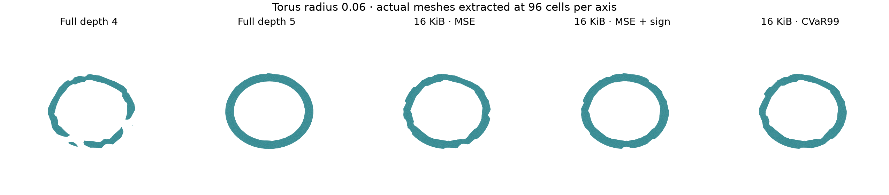
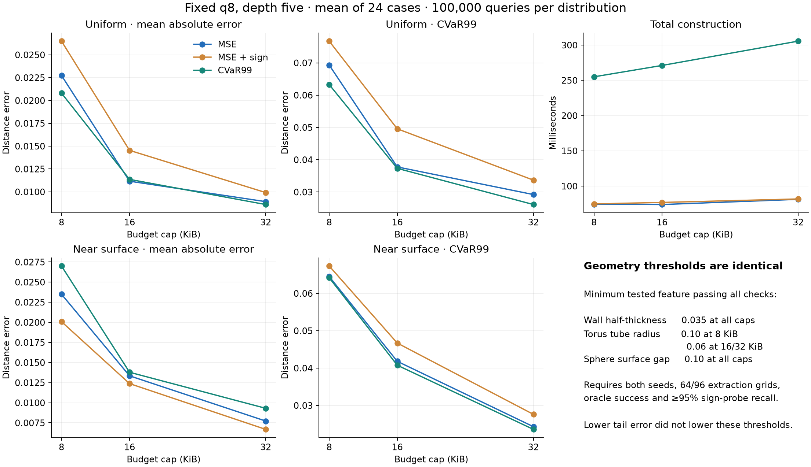

# Direct CVaR99 allocation with fixed q8

Implemented and measured on 8 October 2026. **Direct tail allocation reduces
large errors, but its benefit depends on the query distribution and it does
not lower the measured geometry-recovery thresholds.** At 32 KiB, uniform
CVaR99 falls 10.6% versus MSE; near-surface CVaR99 falls only 3.0%, while
near-surface mean absolute error rises 20.5%. Total construction is 3.76 times
as expensive. Fixed q8 remains the representation throughout.

## First establish whether deeper candidates help

The fully subdivided depth-four and depth-five fields use 84,324 and 674,148
bytes respectively. This deliberately unequal-byte diagnostic isolates the
available spatial resolution; it is not an allocation-policy comparison.
All terminal cells are retained, including those without fitting samples.

| Full q8 field | Depth four | Depth five |
|---|---:|---:|
| Minimum recovered wall half-thickness | 0.035 | 0.020 |
| Minimum recovered torus tube radius | 0.100 | 0.060 |
| Minimum recovered sphere surface gap | 0.100 | 0.100 |

Depth five recovers previously failed wall and torus features under the same
topology and sign-probe criteria, justifying deeper candidates. It does not
resolve the smaller sphere gaps. At feature 0.02, oracle torus/gap extraction
still fails at 64 cells and passes at 96; this remains an extraction-resolution
limit under the two-resolution success criterion.



## Objective and frozen search

For fitting absolute errors e_i, the CVaR99 variational objective is

`F(t) = t + sum_i max(e_i - t, 0) / (0.01*n)`.

For each threshold, every q8 candidate receives the additive excess loss of
the fitting samples routed through it. The existing exact byte-budget DP
then chooses the minimum-loss pruning. Errors use the actual quantized decoder
and interpolation. Cached sorted errors/prefix sums avoid rerunning all fitting
queries for every threshold. This uses the established [Rockafellar–Uryasev
formulation](https://www.sciencedirect.com/science/article/pii/S0378426602002716).

Separate development cases use features 0.03/0.08 and seed 101. The predeclared
rule selected nine equally spaced thresholds from zero to the feasible MSE
field's fitting CVaR99, plus its p99 threshold. Relative to 33 grid points,
the nine-point procedure's fitting F is 0.5907% worse on average and at most
2.6784% worse. It meets the frozen 1%-mean/5%-maximum acceptance rule.

Adding the baseline p99 guarantees a feasible fitting-CVaR upper bound, subject
to floating-point arithmetic. **Each DP is exact, and selection is exact over
the evaluated threshold set.** Neither statement establishes the optimum over
all real thresholds. Nor does the guarantee extend to held-out error or geometry.
The [staged protocol](tail-protocol.md) and pre-run source snapshots preserve
the ordering of these decisions.

## Equal-budget comparison

The final sweep contains 216 fields: three shapes, four features, two fresh
fitting seeds (30/31), three caps and three objectives. All use depth five,
q8 and the same 10,000 fitting points per case: half uniform and half near
surface. MSE uses normalized squared error. The sign objective adds the
existing 0.0025 wrong-sign penalty, without retuning it. CVaR targets the
combined fitting distribution; the two evaluation distributions below are
measured separately.

Each evaluation distribution has **100,000 independent points per case**, giving
exactly 1,000 observations in its worst 1%. Evaluation points are paired across
methods and independent of fitting. Shapes were seen in the resolution check;
these are fresh-sample controlled results, not unseen-shape generalization.
Tables give equal-case means across the 24 shape/feature/seed cases. Percentage
changes are ratios of those means, not averages of per-case percentages.

| Cap | Uniform CVaR99 change, CVaR vs MSE | Uniform MAE change | Near CVaR99 change | Near MAE change |
|---|---:|---:|---:|---:|
| 8 KiB | -8.72% | -8.51% | -0.50% | +14.95% |
| 16 KiB | -1.16% | +1.77% | -2.50% | +3.32% |
| 32 KiB | -10.57% | -3.54% | -2.98% | +20.52% |

| At 32 KiB | MSE | MSE + sign | CVaR99 |
|---|---:|---:|---:|
| Uniform MAE | 0.008928 | 0.009923 | 0.008612 |
| Uniform CVaR99 | 0.029224 | 0.033689 | 0.026136 |
| Near-surface MAE | 0.007725 | 0.006688 | 0.009310 |
| Near-surface CVaR99 | 0.024322 | 0.027621 | 0.023599 |
| Inside feature-probe recall | 84.83% | 87.19% | 83.01% |
| Outside feature-probe recall | 82.78% | 82.62% | 82.62% |
| Mean retained bytes | 32,628 | 32,628 | 32,238 |
| Allocation time | 34.57 ms | 35.17 ms | 259.06 ms |
| Total construction time | 81.26 ms | 81.80 ms | 305.65 ms |

The cap is equal, while actual storage can differ because the exact frontier
prefers fewer bytes on loss ties. No unused capacity is disguised as payload:
every field's actual bytes are exported. At 8/16 KiB, all methods average
8,148/16,356 bytes respectively. At 32 KiB, CVaR uses slightly fewer bytes.

CVaR improves uniform tails in 23/24 cases at 32 KiB, but near-surface tails in
only 16/24. Its worst near-surface regression there is 6.90%. At 8 KiB,
near-surface CVaR improves in only 11/24 cases; the small improvement in the
ratio of means hides a **1.29% increase in mean per-case percentage change**.
The [paired measurements](tail-v1/tail-evaluation-v1-paired.csv) retain this
heterogeneity. Two fitting seeds do not support population-level certainty.



Shared candidate generation averages 31.27 ms and the reusable q8 loss cache
14.03 ms. Allocation time includes one independent solve per baseline/cap and,
for CVaR, the baseline solve plus all threshold solves and small trace writes.
Total construction additionally includes fitting labels and packing. It excludes
evaluation, mesh extraction and evidence serialization. Candidate generation
still constructs the existing three-encoding scratch container; only q8 enters
the allocation and retained fields. Temporary memory is not retained storage.
These are serial timings on one MSVC Release build, not machine-level confidence
intervals or peak-memory measurements.

## Geometry is unchanged between objectives

| Minimum recovered feature, all three policies | 8 KiB | 16 KiB | 32 KiB |
|---|---:|---:|---:|
| Wall half-thickness | 0.035 | 0.035 | 0.035 |
| Torus tube radius | 0.100 | 0.060 | 0.060 |
| Sphere surface gap | 0.100 | 0.100 | 0.100 |

Full wall thickness and torus diameter are twice the listed feature. Success
requires the expected connected components/Euler characteristics, closed
manifold edge and vertex checks, both probe recalls >=95%, oracle success at
64 and 96 cells, both fitting seeds, and success at every larger tested feature.
The 32-cell extractions and failed finest meshes are also retained.

In the depth-five comparison, a 0.06 torus is recovered at 16/32 KiB for
**every** objective.
Direct tail allocation contributes no additional recovery-threshold gain in
this experiment. Even though full depth five recovers a 0.02 wall, none of the
budgeted allocations does. Full depth five also fails the 0.035 torus and the
0.035/0.06 gaps, leaving a representation/resolution issue in those cases.
Adaptive leaves may be discontinuous; topology describes the sampled
reconstruction, not a proof about the continuous adaptive field.

The measured trade-off is therefore a modest tail reduction, often at a
near-surface average-accuracy cost and a substantial construction cost, with
no additional minimum-feature recovery. Tail error alone is an insufficient
selection criterion for the geometry-preservation goal.

## Verification and reproduction

All four local C++ suites pass, including **4,747 tail checks**. The new tests
enumerate all 257 depth-two q8 prunings, compare additive losses against actual
packed queries, test exact budget allocation, independently enumerate the
finite threshold search, and check zero-error/tie and invalid-input cases.
An independent NumPy decoder verifies complete byte coverage, q8-only encoding,
storage caps, fitting objectives and **every saved evaluation query** for all
240 resolution/final fields. Selected losses, threshold grids and winning
finite-search F values are also checked. The CI workflow includes a verified
tail smoke run; remote CI has not been observed.

```powershell
cmake -S . -B build-core -DSDF_WITH_CGAL=OFF
cmake --build build-core --config Release --parallel 4
ctest --test-dir build-core -C Release --output-on-failure
python scripts/tail_run.py runs/tail-resolution-new --exe build-core/Release/sdf_tail_bench.exe --stage resolution
python scripts/tail_run.py runs/tail-development-new --exe build-core/Release/sdf_tail_bench.exe --stage development
# For this frozen protocol; do not reselect the grid from final results.
python scripts/tail_run.py runs/tail-evaluation-new --exe build-core/Release/sdf_tail_bench.exe --stage evaluation --grid 9
# Python with NumPy; add Matplotlib for figures.
python scripts/tail_evidence.py runs/tail-resolution-new runs/tail-development-new runs/tail-evaluation-new --publish runs/tail-archive-new
python scripts/tail_plots.py runs/tail-resolution-new runs/tail-evaluation-new runs/tail-figures-new
python scripts/tail_evidence.py docs/tail-v1 --verify-archives
```

The [evidence index](tail-v1/index.html) links summaries, recovery thresholds,
paired results, source/executable snapshots and split ZIP archives. Raw fitting
and evaluation samples, all final buffers, choices, threshold traces, timings
and finest meshes are retained with SHA-256 manifests. Output directories must
be new; failed or interrupted runs are preserved. Reproduction is toolchain
specific because C++ random-distribution implementations can differ.
